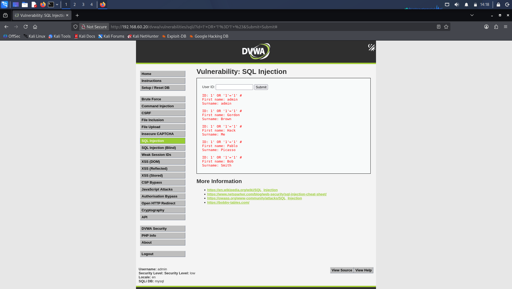
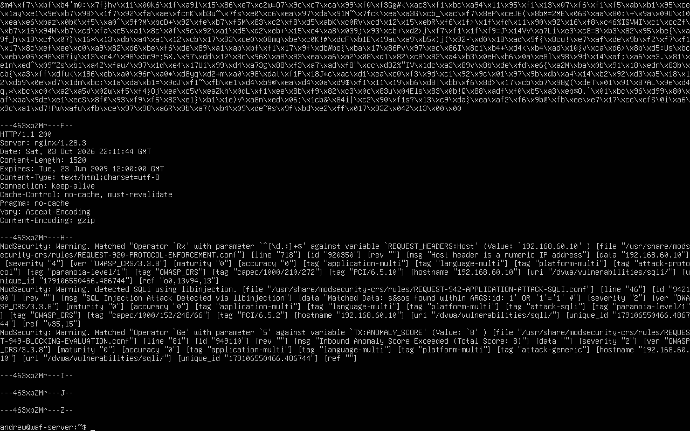
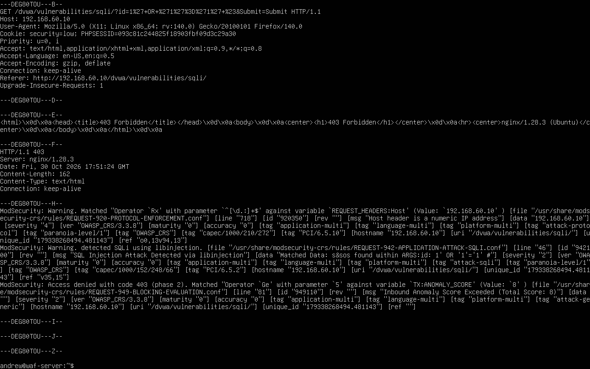
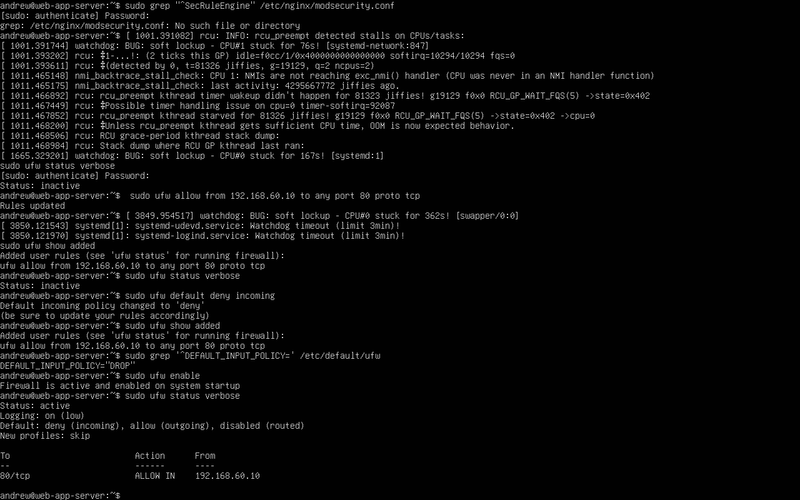
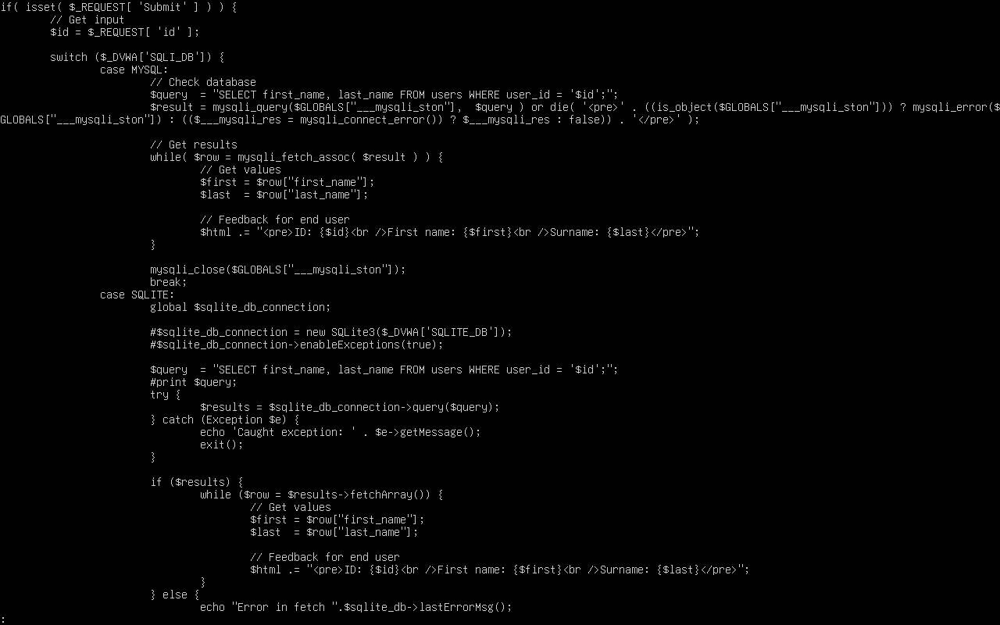

# WAF Attack & Detection Lab

## Project Overview

Built a three-VM cybersecurity lab to simulate SQL injection attacks, analyze web application firewall detections, and implement layered security controls.

The project demonstrates how a vulnerable web application can be exploited, how ModSecurity with the OWASP Core Rule Set detects and blocks malicious requests, and why backend network isolation and secure coding are essential.

## Lab Architecture

```text
Kali Linux (Attacker)
192.168.60.30
        |
        v
Nginx + ModSecurity + OWASP CRS (WAF)
192.168.60.10
        |
        v
Apache + PHP + MariaDB + DVWA (Backend)
192.168.60.20
```

All systems were hosted in VirtualBox on an isolated internal lab network. The backend was later restricted using UFW to allow HTTP access only from the WAF.

## Technologies Used

- Kali Linux
- Ubuntu Linux
- VirtualBox
- Nginx reverse proxy
- ModSecurity v3
- OWASP Core Rule Set (CRS)
- Apache, PHP, MariaDB
- Damn Vulnerable Web Application (DVWA)
- UFW firewall
## SQL Injection Attack Simulation

### 1. Baseline: Successful SQL Injection

Configured DVWA at the Low security level and tested the SQL Injection module from Kali Linux against the backend web application.

**Test payload:**

```sql
1' OR '1'='1' #
```

The application returned all five DVWA user records instead of the single expected record, demonstrating a successful SQL injection against the vulnerable query.

### 2. WAF Detection Mode

Configured ModSecurity with OWASP CRS and set `SecRuleEngine DetectionOnly` to observe malicious requests without blocking them.

The same SQL injection payload continued to return five user records, but the WAF audit logs identified the request:

- **Rule 942100:** SQL Injection Attack Detected via libinjection
- **Matched variable:** `ARGS:id`
- **Inbound anomaly score:** 8
- **Rule 949110:** Inbound anomaly score exceeded threshold
- **HTTP response:** 200 (request allowed in DetectionOnly mode)

This demonstrated the distinction between detecting malicious activity and actively preventing it.

### 3. WAF Prevention Mode

Changed the ModSecurity configuration to `SecRuleEngine On`, validated the Nginx configuration, and reloaded the service.

Replayed the same SQL injection payload through the WAF. The request was blocked with **HTTP 403 Forbidden**.

The audit log confirmed the SQL injection detection and disruptive action, including rule `942100` and the anomaly-based blocking rule `949110`.

### Key Finding

A WAF in detection-only mode can generate useful security telemetry while still allowing an attack to succeed. Enabling blocking mode prevented the tested payload from reaching the vulnerable application through the protected route.
## WAF Bypass and Backend Hardening

### 4. Direct-Origin WAF Bypass

After confirming that ModSecurity blocked the SQL injection through the WAF (`192.168.60.10`), I tested direct access to the backend server (`192.168.60.20`).

The backend remained reachable from Kali Linux, allowing the same SQL injection payload to retrieve all five DVWA user records.

**Finding:** A WAF cannot protect an application when an attacker can bypass it and communicate directly with an exposed backend.

### 5. Backend Firewall Remediation

Configured UFW on the backend Ubuntu server to permit HTTP traffic from the WAF only:

```bash
sudo ufw allow from 192.168.60.10 to any port 80 proto tcp
sudo ufw default deny incoming
sudo ufw enable
sudo ufw status verbose
```

**Validation results:**

- Direct HTTP access from Kali (`192.168.60.30`) to the backend stopped working.
- Legitimate web access through the WAF (`192.168.60.10`) continued working.
- UFW reported an active firewall with default-deny incoming policy and an explicit WAF-to-backend HTTP allowance.

This removed the tested direct-origin HTTP bypass while preserving the intended reverse-proxy path.

## Secure Coding Comparison

### Vulnerable Implementation: DVWA Low

Reviewed the DVWA PHP source code and identified SQL query construction using direct string interpolation:

```php
$query = "SELECT first_name, last_name FROM users WHERE user_id = '$id';";
```

Because the application inserted user input directly into SQL syntax, a crafted payload could change the query's logic.

### Secure Implementation: DVWA Impossible

Reviewed DVWA's Impossible-level PHP implementation and identified a prepared statement with a bound integer parameter:

```php
SELECT first_name, last_name FROM users WHERE user_id = (:id) LIMIT 1;
```

The application uses `bindParam(':id', $id, PDO::PARAM_INT)` and executes the prepared statement, separating user-supplied data from SQL query structure.

This was a source-code comparison, not an independently verified SQL injection test of the Impossible-level implementation.

## Lessons Learned

- **Detection is not prevention:** Security monitoring must be paired with appropriate enforcement.
- **WAFs can be bypassed:** Backend services must not be unnecessarily exposed to untrusted clients.
- **Defense in depth matters:** WAF rules, network access controls, and secure application code address different risks.
- **Parameterized queries are the primary SQL injection defense:** Input validation and WAF filtering provide additional protection but do not replace safe database query construction.
- **Validation is essential:** Security changes should be tested to confirm that malicious access is restricted while legitimate application traffic still works.

## Lab Scope

All testing was performed against intentionally vulnerable systems in a self-hosted, isolated VirtualBox lab. No third-party production systems were targeted.

## Lab Evidence and Screenshots

### 1. Successful SQL Injection and WAF Bypass

The SQL injection payload returned all five DVWA user records when the backend was accessed directly, demonstrating that the origin server remained vulnerable and reachable.



### 2. ModSecurity Detection-Only Logging

OWASP CRS detected the SQL injection using rule `942100`, with an inbound anomaly score of 8. In detection-only mode, the request was logged but not blocked.



### 3. WAF Blocking Evidence

After enabling ModSecurity blocking mode, the same SQL injection payload produced HTTP 403 Forbidden. Rule `949110` enforced the anomaly-score threshold.



### 4. Backend Firewall Configuration

UFW was configured with default-deny incoming traffic and an explicit HTTP allowance from the WAF server at `192.168.60.10`.



### 5. Vulnerable PHP Source Code

DVWA's Low security implementation directly interpolated user input into a SQL query, allowing the SQL injection payload to modify the query logic.



